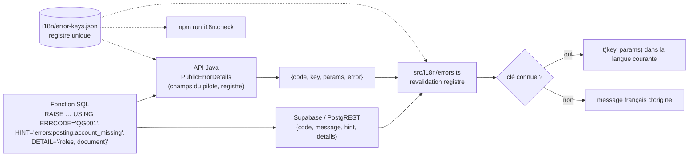

# QERP — Baseline d'architecture i18n / l10n v1.0

État de référence au 26 novembre 2026, après PoC (branche `i18n/poc-langues`, migration V155). Elle consolide
les décisions D-I18N-001 à 010 et les corrections C-01 à C-07. Ce qui est marqué **(PoC)** existe dans le code ;
le reste est la cible.

## 1. Trois réglages indépendants

| Réglage | Décide | Ne décide jamais | Porteurs |
|---|---|---|---|
| Langue (`fr`, `en`) | les textes | formats, devise, règles | plateforme → société → utilisateur ; tiers pour les documents **(PoC)** |
| Locale (`fr-BF`, `fr-FR`, `en-GB`, `en-US`) | séparateurs, ordre des dates | langue, devise | société → utilisateur **(PoC)** |
| Fuseau (IANA) | affichage des horodatages | dates comptables (sans heure) | société **(PoC)** |
| Pays / référentiel | fiscalité, comptabilité, paie | langue, formats | `hr_payroll_settings.country`, référentiels comptables (existant) |

La devise vient toujours de la pièce ou de la société.

## 2. Matrice de résolution linguistique

| Contexte | Ordre | Repli final |
|---|---|---|
| Écran avant connexion | langue du navigateur prise en charge **(PoC)** | `fr` |
| Écran connecté | préférence utilisateur **autorisée** → société → plateforme → source **(PoC, serveur)** | `fr` puis texte d'origine |
| Formats | locale utilisateur → locale société → locale par défaut de la langue **(PoC)** | `fr-FR` (présentation historique) |
| Refus métier | clé traduite dans la langue de l'écran **(PoC)** | message français de la base |
| Document émis | choix explicite → modèle choisi → édition remplacée → client → société → source **(PoC)** ; **figée** | refus si aucun modèle publié dans la langue |
| Document interne non émis | langue de l'écran | — |
| Notification, relance, IA planifiée | langue portée par la donnée (règle, planification) | société, puis `fr` |

Langue désactivée ou retirée de la société : ignorée par la résolution, jamais réécrite ; redevient effective
à la réactivation **(PoC, testé)**.

## 3. Flux d'erreur

## 4. Stockage

| Donnée | Stockage | État |
|---|---|---|
| Textes d'interface | `src/i18n/locales/<langue>/<namespace>.json`, versionnés dans le dépôt | **PoC** : 7 namespaces |
| Clés d'erreur publiques | `services/api/src/main/resources/i18n/error-keys.json` | **PoC** : 6 clés |
| Langues, locales | `languages`, `supported_locales` (référence, lecture seule) | **PoC** |
| Préférences | `tenants`, `profiles`, `customers` (colonnes nullables = hériter) | **PoC** |
| Langues autorisées | `tenant_languages` (vide = toutes) | **PoC** |
| Langue des pièces | `document_templates.language`, `issued_documents.language/locale`, contexte `meta` haché | **PoC** |
| Référentiels globaux traduits | colonne JSONB `label_i18n` | phase 2 |
| Référentiels société traduits | tables `*_translations` (brouillon / publié) | phase 2 |

## 5. Cache et chargement

- Premier rendu : `common`, `nav`, `auth`, `errors` chargés avant `createRoot` ; les autres namespaces avec leur page.
- Bascule : chargement de tous les namespaces ouverts dans la nouvelle langue, puis changement — pas de `Suspense`.
- Préférences : clé de cache TanStack par utilisateur × société × chemin ; cache local `qerp-language:<utilisateur>`.
- Formats : magasin observable (`subscribeFormatPreferences`) ; `useLocaleFormat()` redessine sur changement de locale seule.

## 6. Sécurité

- Isolation : `tenant_languages` sous RLS ; écritures par fonctions `SECURITY DEFINER` qui résolvent la société
  de l'appelant ; `language_allowed` révoquée des utilisateurs ; isolation V55 réinstallée.
- Droits : `languages.settings` (catalogue, admin par défaut), contrôlé par la base **et** par `module-access.json`.
- Gardes sur tous les chemins d'écriture : langue source, fuseau, langue de profil (garde V24 intact).
- Aucune donnée brute exposée : clé et paramètres filtrés par registre, types et longueurs bornés.
- Textes rendus comme texte (React) ; gabarits de documents échappés (V141 inchangé).

## 7. Dépendances introduites

| Paquet | Version | Rôle |
|---|---|---|
| `i18next` | 27.2.9 (exacte) | moteur de traduction |
| `react-i18next` | 18.0.3 (exacte) | liaison React |
| `eslint-plugin-i18next` | 6.1.5 (exacte, dev) | règle `no-literal-string` sur le périmètre traduit |

## 8. Limites connues

- Premier écran +21,1 Ko gzip (budget +10) : voir P-I18N-02 dans le registre.
- Montants et dates des pièces émises non formatés par locale (comme V141) ; montant en lettres anglais absent.
- Messages d'alerte (`erp_alerts`) et e-mails de relance : texte stocké, non traduit (phase 2).
- Composants partagés traduits (éditeur de lignes) apparaissent en anglais dans des écrans encore français, sous
  l'avertissement explicite.

## 9. Paliers

| Capacité | MVP | Commercial Stable | Enterprise |
|---|---|---|---|
| fr / en, préférences, bascule à chaud | PoC fait → généraliser | oui | oui |
| Refus métier traduits | 100 % refus critiques | ≥ 95 % sites RAISE applicables | 100 % |
| Documents | facture ; autres pièces commerciales | toutes pièces, bulletin | + formats avancés |
| Référentiels traduits | selon criticité | oui | oui |
| LMC | onglet simple (fait) | LMC société, revue à deux | + IA, versions |
| Langues supplémentaires, RTL | architecture prête (`dir`, propriétés logiques) | selon marché | oui |
