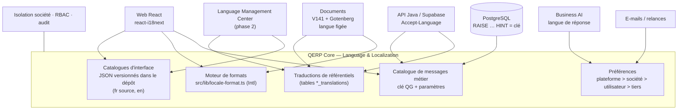

# QERP — Architecture cible i18n / l10n

Proposition à valider (voir `QERP_I18N_DECISION_REGISTER.md`). Rien n'est implémenté.

## 1. Vue d'ensemble



## 2. Frontend

### Choix de bibliothèque (D-I18N-002)

| Critère | i18next + react-i18next | FormatJS / react-intl |
|---|---|---|
| Format des messages | JSON clé → texte, ICU via plugin | ICU MessageFormat natif |
| Pluriels | règles CLDR (`_one`, `_other`) | ICU `plural` |
| Namespaces / chargement paresseux | natif (backend + `Suspense`) | à construire |
| Changement de langue à chaud | `i18n.changeLanguage`, sans rechargement | re-render du provider |
| Utilisation hors React (hooks, `src/lib`, toasts) | instance `i18n.t` importable | `createIntl` à câbler |
| Écosystème (extraction, lint, TMS) | très large | bon |
| Formats nombres / dates | délégués à `Intl` | intégrés (`FormattedNumber`) |

**Recommandation : i18next + react-i18next**, formats confiés à un module `Intl` maison. Raisons : 457 toasts
sont émis depuis des hooks hors composants, le découpage par module colle au code splitting existant (pages
`React.lazy`), et le changement à chaud est natif.

### Organisation

```
src/i18n/
  index.ts                 # instance, détection, repli fr, chargement paresseux
  locales/fr/common.json   # boutons, statuts génériques, erreurs génériques
  locales/fr/sales.json    # un namespace par module du menu
  locales/en/...
  errors/fr.json           # messages QGxxx par clé
src/lib/locale-format.ts   # formatMoney, formatNumber, formatDate, formatDateTime, monthName
```

- Les fichiers `fr` sont la source ; `en` est généré par traduction humaine.
- Un namespace par module, chargé avec sa page (`import()` Vite) : le premier écran ne grossit que de `common`.
- `<html lang>` et `dir` mis à jour au changement de langue (prépare le RTL).
- Formateurs : la locale vient des préférences, la devise et les décimales de la donnée.

## 3. Backend

### Messages de la base (D-I18N-004)

Situation : ≈ 1 900 textes FR dans `RAISE EXCEPTION`. Proposition **hybride et progressive** :

```sql
RAISE EXCEPTION 'Compte manquant pour le rôle %', _role       -- texte FR conservé (repli)
  USING ERRCODE = 'QG001',
        HINT    = 'i18n:posting.account_missing',              -- clé stable
        DETAIL  = jsonb_build_object('role', _role)::text;     -- paramètres
```

- `DatabaseRefusalAdvice` (Java) et le client Supabase exposent `code`, `key`, `params`, `error` (texte d'origine).
- Le front affiche `t(key, params)` s'il connaît la clé, sinon `error` : **aucune régression** possible.
- Conversion par module, en commençant par les 144 codes QG les plus fréquents ; les nouvelles fonctions naissent avec une clé (règle de revue).

### API Java

- `LocaleResolver` lisant `Accept-Language` (langues actives seulement, sinon préférence utilisateur, sinon société).
- `MessageSource` (`messages_fr.properties`, `messages_en.properties`) pour les ≈ 718 messages propres à l'API.
- Bean Validation : messages par clé (`{qerp.validation.required}`).
- Corps d'erreur : `{code, key, params, error}` ; le contrat OpenAPI est mis à jour en conséquence.
- Traitements asynchrones (`AiScheduler`, relances, rendu PDF) : la langue est **une donnée du travail**
  (colonne de la planification ou du document), jamais le contexte de thread.

### Edge functions

Même contrat d'erreur ; langue reçue du front ou lue sur l'objet traité (règle, document, planification).

## 4. Base de données

Voir `QERP_I18N_DATA_MODEL.md`. Résumé : colonnes de préférence (`profiles`, `tenants`, tiers), tables de
traduction relationnelles pour les référentiels, langue figée dans le contexte des documents émis.

## 5. Documents et reporting

- Contexte V141 enrichi de `language`, `locale`, `labels` (libellés résolus à l'émission) avant hachage.
- `document_templates` : une version par langue ; le rendu ne lit jamais de catalogue à la réimpression.
- `printDocumentPDF` / `documentXlsxBytes` : libellés par `t()` dans la langue du document, `montantEnLettres(montant, langue)`.

## 6. Cache, performance, disponibilité

- Catalogues d'interface **statiques**, livrés avec le build : aucun service distant par libellé.
- Traductions de référentiels lues avec les référentiels (jointure ou vue), cache TanStack Query indexé par langue.
- Traductions société (phase 2) : une requête par namespace et par session, invalidée à la publication.
- Coût mesuré au Lot 0 : `common` ≈ quelques ko gzip [H, à mesurer en phase 1].

## 7. Sécurité

- Traductions société sous RLS + `trg_zz_isolation_societe` (règle V55).
- Écriture par droits du catalogue (`i18n.translate`, `i18n.review`, `i18n.publish`), jamais par rôle en dur.
- Textes traduits rendus comme texte (React échappe ; les modèles V141 échappent déjà le HTML).
- Import de fichiers : validation des clés connues, variables d'interpolation identiques à la source, taille bornée.
- Clés réservées (messages légaux, mentions obligatoires) non surchargeables par une société.

## 8. Mobile et IA

- Mobile (absent aujourd'hui) : réutiliserait les mêmes JSON (i18next fonctionne en React Native).
- IA : prompt système paramétré par la langue de l'utilisateur ; glossaire métier (codes et comptes jamais traduits) injecté dans le prompt.

## Note de consolidation — 26 novembre 2026, après-midi (C-01, C-04) — remplace les exemples §3

- **Clé canonique** : `errors:<domaine>.<cas>` (ex. `errors:posting.account_missing`), indépendante du code
  (`QG001`). HINT porte la clé canonique **sans préfixe de transport** ; l'exemple `i18n:posting.account_missing` du
  §3 et `errors:QG001.account_missing` des normes sont abandonnés. Les 95 HINT existants en texte libre ne
  correspondent pas au motif de clé et ne sont jamais pris pour une clé.
- **DETAIL** : objet JSON des seuls paramètres publics. Registre unique `services/api/src/main/resources/i18n/error-keys.json`
  (clé → paramètres autorisés), lu par Java (`PublicErrorDetails`) et par le front (`src/i18n/errors.ts`) ; le contrôle
  CI vérifie que chaque clé enregistrée a sa traduction et n'utilise que des paramètres déclarés.
- **Contrat** : `{ "code": "QG001", "key": "errors:posting.account_missing", "params": {"roles": ["AR_RECEIVABLE"], "document": "FV-1"}, "error": "Paramétrage comptable incomplet : …" }`.
  Statuts HTTP et champs historiques inchangés ; `key` / `params` n'apparaissent que validés.
- **Java** : HINT / DETAIL lus dans les champs structurés du pilote (`getServerErrorMessage()`) — le texte de
  `getMessage()` est traduit par le pilote selon la langue de la JVM et ne doit pas être analysé.
- **Supabase** : PostgREST transmet `hint` / `details` au navigateur par construction ; ils ne contiennent donc
  que des paramètres publics (règle de revue), et le front les revalide contre le registre.
- **Accept-Language** : l'API ne traduit pas ; elle renvoie la clé, le front traduit. Une seule source de vérité
  (catalogues du dépôt), pas de `MessageSource` dupliqué. Les traitements asynchrones (rendu PDF, relances, IA
  planifiée) lisent leur langue sur la donnée traitée (édition, règle, planification), jamais sur le thread.
- **Cache** : clé TanStack `["language-context", utilisateur, société, chemin]` ; cache local par utilisateur
  (`qerp-language:<id>`), jamais relu avant connexion ni par un autre compte ; vidé avec le reste au `SIGNED_OUT`.
- **Bascule** : tous les namespaces ouverts sont chargés dans la nouvelle langue **avant** le changement : aucun
  `Suspense`, aucun formulaire démonté.
